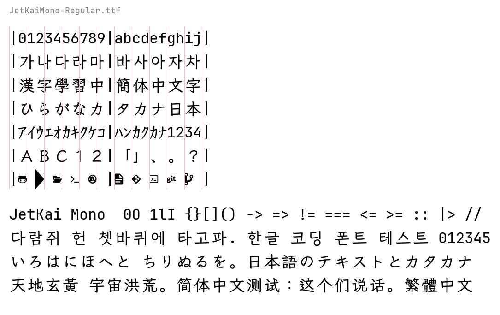

# JetKai Mono

JetBrains Mono Nerd Font + LXGW WenKai Mono KR: a monospace coding font where CJK characters are exactly two cells wide.



## What's inside

Glyphs come from three layers; a codepoint is taken from the first layer that has it.

| Layer | Source | Provides |
|---|---|---|
| 1 | [JetBrains Mono NL/ligature Nerd Font Mono](https://github.com/ryanoasis/nerd-fonts) v3.5.1 | Latin, Cyrillic, Greek, box drawing, Powerline and Nerd Font icons |
| 2 | [LXGW WenKai Mono KR](https://github.com/lxgw/LxgwWenkaiKR) v0.902 | Hangul (11,172 syllables), Hanja in Korean forms, kana, CJK punctuation |
| 3 | [LXGW WenKai Mono](https://github.com/lxgw/LxgwWenKai) v1.530 | Remaining Han characters: Simplified Chinese, Extension A, part of Extension B |

Coverage per style: all Hangul syllables and compatibility jamo, all Hiragana and Katakana
(including halfwidth), all 20,992 CJK Unified Ideographs and 6,592 Extension A ideographs.

Two families are built, each in eight styles:

- **JetKai Mono**: JetBrains Mono with ligatures
- **JetKai Mono NL**: no ligatures

| Style | JetBrains Mono | WenKai weight |
|---|---|---|
| Light, Light Italic | Light | Regular |
| Regular, Italic | Regular | Medium |
| Medium, Medium Italic | Medium | Medium |
| Bold, Bold Italic | Bold | Medium |

WenKai strokes are thinner than JetBrains Mono's, so each style uses the next heavier WenKai weight.

## Width rules

Terminals decide how many cells a character takes from Unicode East Asian Width, so the font
follows the same rule instead of trusting the source font:

- Wide / Fullwidth (`W`, `F`): 1200 units, two cells
- Halfwidth / Narrow (`H`, `Na`, `N`): 600 units, one cell (e.g. halfwidth katakana `ｱｲｳ`)
- Ambiguous (`A`): the source design's width
- Combining marks: zero width

A wide source glyph that must fit one cell is squeezed horizontally. A narrow source glyph in a
two-cell slot is centred rather than stretched. CJK glyphs are scaled by `cjk_scale` and centred
vertically on JetBrains Mono's line, so they sit inside the terminal cell. Nerd Font icons keep
their one-cell width from the Nerd Font Mono base.

## Build

Requires [uv](https://docs.astral.sh/uv/).

```bash
uv sync
uv run jetkai fetch      # download the pinned sources into sources/ (sha256-checked, ~200 MB)
uv run jetkai build      # build all fonts into output/ttf and verify them
uv run jetkai preview    # render PNG specimens into output/preview
```

A full build of 16 fonts takes about two minutes with six jobs. Useful options:

```bash
uv run jetkai build --variants nl --styles Regular,Bold -j 2
uv run jetkai verify output/ttf/JetKaiMono-Regular.ttf
```

`verify` checks that every advance is 0, 600 or 1200, that CJK advances agree with East Asian
Width, that CJK glyphs fit inside the line metrics, that the glyph count stays under 65,535,
and prints a coverage table.

Everything else lives in [`config.yaml`](config.yaml): source URLs and hashes, styles, the CJK
weight per style, layer order, imported Unicode ranges, and the CJK scale and vertical centre.

## Known limitations

- WenKai has no Bold, so Bold styles use Medium CJK, which looks lighter than the bold Latin.
- CJK glyphs stay upright in italic styles.
- Shared Han characters use Korean glyph forms, because the KR layer comes first.
- Conjoining Hangul jamo (U+1100–11FF, used by NFD text such as macOS file names) are not in any
  WenKai font. Precomposed Hangul is complete.
- WenKai's own OpenType features (vertical forms, punctuation width variants) are not carried over.
- Each TTF is about 28 MB.

## License

The fonts are licensed under the [SIL Open Font License 1.1](OFL.txt). LXGW WenKai reserves the
font names "LXGW", "霞鹜", "霞鶩", "落霞孤鹜" and "落霞孤鶩", so modified versions must not use them.
Nerd Fonts glyphs are MIT licensed. The build scripts are [MIT licensed](LICENSE).

## Acknowledgements

- [JetBrains Mono](https://github.com/JetBrains/JetBrainsMono) and [Nerd Fonts](https://github.com/ryanoasis/nerd-fonts)
- [LXGW WenKai](https://github.com/lxgw/LxgwWenKai) and [LXGW WenKai KR](https://github.com/lxgw/LxgwWenkaiKR), derived from Fontworks' [Klee One](https://github.com/fontworks-fonts/Klee)
- [JetBrainsLxgwNerdMono](https://github.com/lvbibir/JetBrainsLxgwNerdMono) for the original idea
